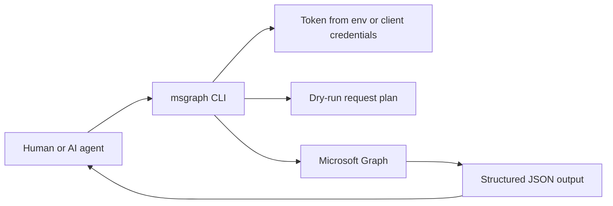

<!-- jr-brand:start -->
<div align="center">
  <a href="https://jannikreinhard.com/">
    
  </a>
  <h1>Microsoft Graph CLI</h1>
  <p><strong>Agent-friendly Microsoft Graph requests from the terminal with predictable JSON output.</strong></p>
  <p>
  <a href="https://jannikreinhard.com/"></a>
  <a href="https://github.com/JayRHa"></a>
  <a href="https://www.linkedin.com/in/jannik-r/"></a>
  <a href="https://x.com/jannik_reinhard"></a>
  <a href="https://www.youtube.com/@jannikreinhard"></a>
  </p>
  <p><sub>Driving AI with passion · Microsoft Foundry · Intune · Azure</sub></p>
</div>
<!-- jr-brand:end -->

Agent-friendly Microsoft Graph requests from the terminal with predictable JSON output.

Query. Inspect. Automate.


Microsoft Graph | Python CLI | JSON-first | Agent Ready


## Overview

Microsoft Graph CLI is a small command line toolkit for working with Microsoft Graph in scripts, terminals and AI-agent workflows. It provides a curated endpoint catalog for common Microsoft 365, Entra ID and Intune reads, plus a generic `call` command for any Graph path.

The tool is intentionally simple: authentication can come from an existing access token or Azure client credentials, every command emits deterministic JSON, and `--dry-run` prints the exact request before touching a tenant.

## How It Works



## Quickstart

```bash
git clone https://github.com/JayRHa/MicrosoftGraphCLI.git
cd MicrosoftGraphCLI
python -m pip install -e .

export MSGRAPH_ACCESS_TOKEN="<access-token>"
msgraph endpoints
msgraph users --top 5 --select id,displayName,userPrincipalName
```

Use client credentials instead of a prebuilt token:

```bash
export AZURE_TENANT_ID="<tenant-id>"
export AZURE_CLIENT_ID="<app-registration-client-id>"
export AZURE_CLIENT_SECRET="<client-secret>"

msgraph managed-devices --top 10 --dry-run
```

## Commands

| Command | Purpose |
| --- | --- |
| `msgraph endpoints` | List curated endpoint keys, paths and required Graph permission scopes. |
| `msgraph call` | Execute any Microsoft Graph request by endpoint key or raw path. |
| `msgraph users` | List users with common `$top`, `$select` and `$filter` controls. |
| `msgraph managed-devices` | List Intune managed devices through Microsoft Graph. |

## Examples

```bash
msgraph endpoints --category intune
msgraph call --endpoint user --path-param id=alex@example.com --dry-run
msgraph call --method GET --path /organization
msgraph call --endpoint sign-ins --query '$top=10' --query '$filter=createdDateTime ge 2026-05-01T00:00:00Z'
```

## Authentication

The CLI checks authentication in this order: `--access-token`, `MSGRAPH_ACCESS_TOKEN`, `AZURE_ACCESS_TOKEN`, then client credentials from `AZURE_TENANT_ID`, `AZURE_CLIENT_ID` and `AZURE_CLIENT_SECRET`.

## Output Contract

All successful commands write JSON to stdout. Errors are written to stderr with a non-zero exit code, which makes the CLI predictable for shell scripts, CI jobs and agent toolchains.

## License

MIT License. See [LICENSE](LICENSE).

<!-- jr-brand-footer:start -->

---

<div align="center">
  <p><sub>Built and maintained by <a href="https://jannikreinhard.com/">Jannik Reinhard</a> · Microsoft MVP for Security and AI Platform.</sub></p>
  <p><a href="https://www.buymeacoffee.com/jannikreinf">Support the open-source work</a></p>
  <p><strong>Stay healthy, Cheers Jannik</strong></p>
</div>

<!-- jr-brand-footer:end -->
